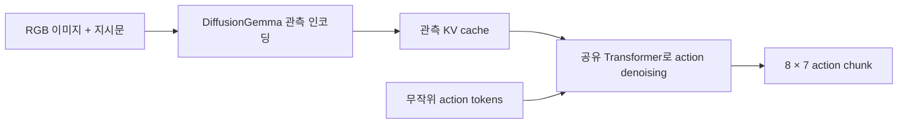

# DecisionVLA

**DiffusionGemma를 로봇 action을 직접 생성하는 VLA로 적응시키는 개인 실험입니다.**

[English](README.en.md) · [학습 방법](docs/training.md) · [실측 결과](reports/base-latency-2026-10-24/report.ko.md) · [가중치 배포](docs/weights.md)

이미지와 지시문을 받아 앞으로의 8개 행동을 병렬 생성합니다. 내장 vision encoder와 공유 Transformer를 사용하며, 별도 action expert나 world model을 추가하지 않습니다. 구현 과정과 실험 결과를 공유하기 위한 프로젝트입니다.



## 현재 상태

| 항목 | 상태 |
|---|---|
| LIBERO-Spatial 데이터 | 공식 원본 500개 시연, SHA·시점 정렬 검사 |
| 학습 구현 | 공유 attention LoRA + native action embedding rows |
| 최초 학습 | GPU 1장, 450개 시연 학습 / 50개 시연 검증, 2,000 updates |
| 추론 구현 | BF16 reference API; 약 51GiB 이상 필요 |
| NVFP4 | **기본 모델 비용 측정 완료. 학습된 정책의 export는 아직 미완료** |
| 로봇 성공률 / RTX 5090 | 아직 측정하지 않음 |

학습·검증 상세 상태는 [첫 run 기록](reports/libero-spatial-pilot/README.md)에 남깁니다. 현재 프로젝트를 검증된 로봇 정책으로 소개하지 않습니다.

## 무엇을 학습하나요?

- Base: [`google/diffusiongemma-26B-A4B-it`](https://huggingface.co/google/diffusiongemma-26B-A4B-it), revision 고정.
- Encoder/decoder에 **같은 LoRA**를 적용합니다. Vision, MoE experts, router와 원래 가중치는 동결합니다.
- 확인된 unused vocabulary 256개를 action bins로 사용합니다. 입력 embedding과 출력 readout의 action rows를 함께 학습합니다.
- 연속 제어 6차원은 `[-1, 1]`의 256 bins, gripper는 두 값입니다. 8-step chunk의 56개 위치를 timestep 순서로 씁니다.
- 정답 action에 uniform noise를 섞어 복원하는 denoising CE로 학습합니다. 이번 pilot은 self-conditioning을 사용하지 않습니다.
- Native 256-token canvas 중 나머지 200개 위치는 고정 padding이며 attention key에서 제외합니다.

공식 HDF5에서 관측은 해당 action을 실행한 뒤 저장됩니다. 이번 구현은 `obs[t] → actions[t+1:t+9]`로 맞췄고, 전체 61,750개 인접 상태에서 관절 좌표 일치를 확인했습니다. 자세한 계약은 [학습 문서](docs/training.md)에 있습니다.

## 시작하기

Linux, Python 3.12, CUDA 13을 지원하는 NVIDIA driver를 기준으로 검사했습니다. BF16 학습에는 96GB GPU 한 장을 사용합니다.

```bash
git clone https://github.com/taewan2002/DecisionVLA.git
cd DecisionVLA
uv venv --python 3.12
source .venv/bin/activate
uv pip install torch==2.9.1 torchvision==0.24.1 --index-url https://download.pytorch.org/whl/cu130
uv pip install -e '.[dev]'

python scripts/download_libero.py --output data
hf download google/diffusiongemma-26B-A4B-it \
  --revision f7f5b7f5fa82ffc52addd066915886d497f5517b --local-dir models/base
pytest -q
python scripts/audit_data.py --data data --output data/audit.json

CUDA_VISIBLE_DEVICES=0 python -m decisionvla.train \
  --model models/base --data data --output runs/smoke --smoke
CUDA_VISIBLE_DEVICES=0 python -m decisionvla.train \
  --model models/base --data data --output runs/libero-spatial
```

추론은 저장된 adapter와 원본 base를 함께 불러옵니다. 아래 API는 BF16 reference이며 **5090용 NVFP4 runtime은 아직 아닙니다**.

```python
from PIL import Image
from decisionvla.policy import DecisionVLA

policy = DecisionVLA("models/base", "runs/libero-spatial/checkpoint-002000")
# Raw LIBERO camera images and HDF5 frames use the same 180° rotation.
image = Image.open("agentview.png").convert("RGB").transpose(Image.Transpose.ROTATE_180)
actions = policy.predict(image, "pick up the black bowl and place it on the plate", steps=4)
assert actions.shape == (8, 7)
```

## 측정한 추론 비용

RTX PRO 6000 Blackwell 96GB, 500W 설정, vLLM 0.30.0, batch 1, 이미지 1장, native 256-token canvas입니다. **미학습 기본 모델 + synthetic image의 비용 기준선**이며, 위 action sampler의 속도나 LIBERO 성공률은 아닙니다.

| Denoising steps | NVFP4 p50 / p95 | BF16 p50 / p95 |
|---|---:|---:|
| 1 | 89.8 / 90.9 ms | 128.9 / 130.2 ms |
| 2 | 107.4 / 109.3 ms | 157.3 / 160.5 ms |
| 4 | 144.7 / 146.4 ms | 221.2 / 225.7 ms |
| 8 | 221.3 / 222.8 ms | 352.5 / 356.9 ms |

관측된 전체 GPU 메모리 최대치는 NVFP4 **22.26GiB**, BF16 **53.02GiB**였습니다. 5090에서 같은 속도가 나온다는 의미는 아닙니다. [원시 측정값·조건](reports/base-latency-2026-10-24/)과 [재현 명령](docs/benchmark-protocol.md)을 제공합니다.

## 다음 단계

1. 고정 checkpoint로 LIBERO closed-loop rollout 평가.
2. BF16 + LoRA merge, 로봇 데이터 calibration, NVFP4 export.
3. 같은 입력·noise에서 reference와 가속 runtime의 action 일치 검사.
4. RTX 5090에서 성공률·지연·최대 메모리 실측.

NVFP4와 직접 action diffusion 자체를 최초 기여로 주장하지 않습니다. 성공한 부분과 실패한 부분을 함께 기록합니다.

## 코드와 가중치

코드는 MIT입니다. Base model, NVIDIA quantized model, LIBERO 데이터에는 각각의 upstream 조건이 적용됩니다. [출처·라이선스](docs/third-party.md)를 참고하세요.

Adapter는 검증 후 이 저장소의 **GitHub Releases**에 `safetensors`, config, model card, SHA256으로 배포할 계획입니다. Base weight·dataset·optimizer state는 Git에 넣지 않습니다. 별도의 HF 배포 저장소는 필요하지 않습니다.

이 프로젝트는 Google, NVIDIA, LIBERO, open-jev의 공식 프로젝트가 아닙니다.
