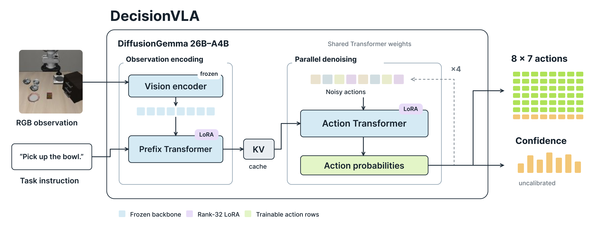

# DecisionVLA architecture figure

[SVG](decisionvla-architecture.svg) · [Editable Figma](https://www.figma.com/design/FbL9C7OnlyOZkiyGPOkcW0/?node-id=13366-92873) · [Current authoring script](simplify-figma.js)

The compact figure follows the visual style of the adjacent RetoVLA figure: white background, short labels, colored computation blocks and token grids. It contains 47 words instead of 237. The old detailed DecisionVLA version is preserved as a hidden Figma backup; all 30 sibling figures retained their structural fingerprints. The current native frame is 1280×480, exported as a 2× PNG and outlined-text SVG. See [QA evidence](compact-figure-qa.json).

## Reading the figure

An RGB observation and instruction form the observation prefix. The frozen native vision stack feeds the prefix Transformer. Its KV cache is reused by the action Transformer. These are two execution modes of the same text weights and shared rank-32 LoRA, not separate models or an added action expert.

All 56 action positions are denoised together. The illustrated four-pass loop includes categorical sampling and decreasing uniform re-noising between intermediate passes; the final pass uses argmax. The native tied action-token readout produces conditional probabilities. Six controls use 256 bins; the gripper allows only the two endpoint bins. The output is eight timesteps of seven normalized controls.

Raw confidence is computed from the same final distribution, without an extra learned module or model forward. It does not change execution and is not a calibrated probability of task success. Action cells and confidence bars are schematic, not measured outputs. The loop count is the current evaluation setting, not an architectural constant.

The backbone and vision are frozen; LoRA adapts attention, dense MLP and routed experts, and tied action embedding/readout rows are trainable. The original 2k objective supervised all valid positions. Subsequent training uses only valid positions selected for random replacement, including chance matches. The [50k training contract](../../docs/training-50k.md) records that history. Padding and loss details belong in the documentation rather than the overview figure.

## Provenance

The observation image is a 128×128 LIBERO-Spatial agentview frame from demo 0, frame 0 of `pick_up_the_black_bowl_between_the_plate_and_the_ramekin_and_place_it_on_the_plate`, rotated 180° using the policy input convention. Its instruction is shortened in the illustration. The image retains the dataset's upstream terms; see [third-party attribution](../../docs/third-party.md).

Implementation: [model](../../src/decisionvla/model.py), [adapters](../../src/decisionvla/adapters.py), [policy](../../src/decisionvla/policy.py), [confidence](../../src/decisionvla/confidence.py) and [codec](../../src/decisionvla/codec.py). The older `build-figma.js` and `update-confidence-figma.js` record previous authoring stages and should not be replayed over the compact frame.

The figure makes no robot-success, confidence-based-control, trained NVFP4 or measured RTX 5090 claim.
