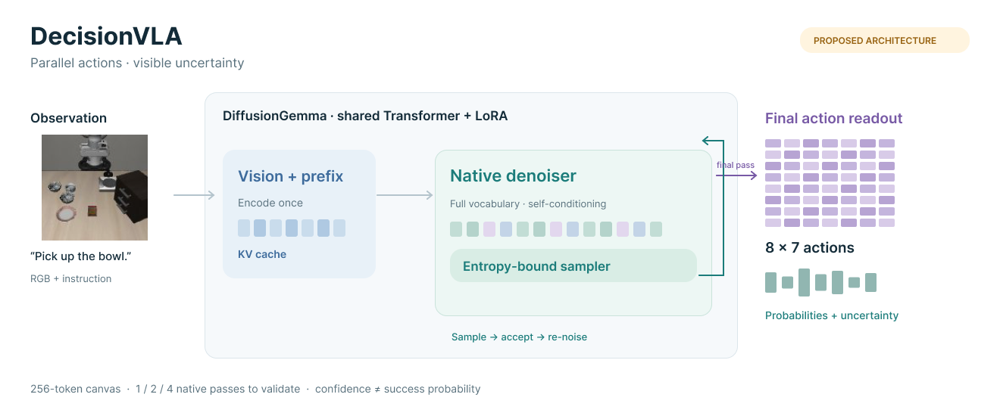

# DecisionVLA architecture proposal

[Editable Figma](https://www.figma.com/design/FbL9C7OnlyOZkiyGPOkcW0/?node-id=13407-92873) · [SVG](architecture.svg) · [Authoring script](build-figma.js)

This1320×550 editable native-vector figure describes the proposed architecture,
not the implementation used for existing results. The earlier pilot figure remains
preserved in [decisionvla-architecture](../decisionvla-architecture/). The new frame
is inside the existing Frame2117910921 and does not replace neighboring projects.

The central group represents one backbone with shared Transformer/LoRA weights.
The observation prefix is cached once, while the denoiser keeps full-vocabulary
predictions, native self-conditioning and entropy-bound sampling. Only final
readout restricts actions. The1/2/4-pass choices require quality–latency validation.
Cells and bars are schematic, not measured probabilities; raw confidence is not
success probability. See the [exact design](../../docs/architecture.md).

The observation is reused from the existing LIBERO-Spatial figure: demo0/frame0,
`pick_up_the_black_bowl_between_the_plate_and_the_ramekin_and_place_it_on_the_plate`,
rotated180° under the pilot convention. Its shortened instruction is illustrative.
Dataset attribution and terms remain in [third-party](../../docs/third-party.md).
