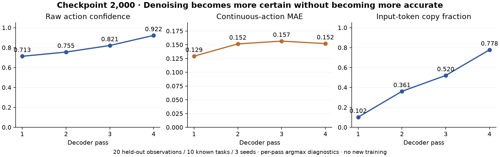

# Denoising diagnosis and 10k continuation

Status (2026-10-24): the 2k diagnostic and raw-probability replay/audit completed. All 280 distributions passed recomputation, and all 280 event rows exactly matched the initial probe. Confidence increased in 20/20 observations; MAE increased in 14/20 (averaged across the three seeds). The original 500-episode evaluation completed and the separate corrected 10k continuation started on 2026-10-24 at 23:03 KST. A [50k follow-up](../training-schedule-50k/README.md) is now queued behind the complete 10k evaluation.

Twenty held-out demonstration observations (two per Spatial task, selection seed 20261024) were sampled with seeds 42/43/44. The four decoder passes used the same observation and prefix cache. This is a post-hoc mechanism diagnostic on known tasks, not a rollout or a success calibration experiment.

| Decoder pass | Raw confidence | Continuous-action MAE | Input-token copy fraction |
| --- | ---: | ---: | ---: |
| 1 | 0.71295 | 0.12923 | 0.10208 |
| 2 | 0.75507 | 0.15152 | 0.36101 |
| 3 | 0.82117 | 0.15653 | 0.52044 |
| 4 | 0.92221 | 0.15203 | 0.77768 |

Confidence increased while final MAE was 17.65% higher than first-pass argmax MAE. Intermediate predictions in this table are per-pass argmax readouts; the actual sampler uses multinomial draws before re-noising between passes. The result implicates the complete refinement path, not only a single loss term.

With a ground-truth canvas, input copy fraction was 99.91% and confidence 0.99597. With translation bins deliberately shifted by 64 modulo 256 and gripper endpoints flipped, copy fraction was **97.41%**, confidence **0.96347**, translation MAE **0.59151**, and gripper accuracy **0.625%**. The control demonstrates strong dependence on a deliberately incorrect canvas; it is an artificial intervention, not an estimate of how often such errors occur in normal rollouts.

The current checkpoint can become more certain through refinement without becoming more accurate. The legacy objective rewarded every valid position, including clean unchanged targets. This supplies a direct identity-reconstruction reward. Its causal contribution to the measured failure has not been isolated from sampling, training budget and other model properties.

## Targeted change and training contract

- New `denoising_loss_scope=resampled_only`: supervise valid positions selected for random replacement. Padding and unselected clean targets receive no target loss. Coincidental noise/target matches stay supervised; excluding them would create an always-flip shortcut for the binary gripper. A rare empty selection resamples one uniformly selected valid position without conditioning its noise value on the target. Legacy configs default to `all_valid` with the original noise RNG behavior.
- Continue from checkpoint 2,000 to **10,000 total updates**, carrying adapter, optimizer and all saved RNG states into a separate run. Preserve the original run and every original checkpoint. This is **2k legacy-objective updates + 8k corrected-objective updates**, not a 10k corrected run from scratch.
- Keep rank 32, the existing attention/dense/expert targets, effective batch 8, data split, action alignment, camera and four-pass/eight-control decoding. Extend the schedule explicitly: start at the former `1e-5` LR, warm over 100 updates toward `5e-5`, then cosine decay to `5e-6`. Save every 500 updates and validate 100 fixed held-out observations every 500 updates; the new baseline is measured before update 2,001.
- The controller waits for the old 500-episode evaluation and its audit to finish. It requires the completed denoising audit and preserved source hashes, then runs a disposable continuation smoke with real gradients and checkpoint/RNG resume verification. Only a passing smoke starts the full continuation from the original 2k parent.
- GPU0 only; 600W during training, prior cap restored for evaluation. Other GPU workloads are preserved. The bounded diagnostic uses CPU-offloaded experts, peaked at 25.83 GiB allocated GPU memory, and its overlap with the existing evaluation is marked as a contended interval for latency interpretation.
- At step 10,000, rerun the identical denoising diagnostic and the fixed Spatial 10 tasks × 50 initial states evaluation, including action/confidence parity and raw trace audit. These are reused development initial states. Both the objective and training budget change, so any improvement is not a controlled estimate of the objective's isolated effect.

The change removes a specific identity-reconstruction incentive; whether it improves refinement and rollout success is **pending measurement**. Raw confidence remains uncalibrated. Do not publish the 2k pilot as the finished release while this follow-up is active.

Configuration: [`libero_spatial_r32_corr_10k.json`](../../configs/libero_spatial_r32_corr_10k.json), [`confidence_analysis_10k.json`](../../configs/confidence_analysis_10k.json). Entry points: `decisionvla.train --extend-from PARENT`, `scripts/probe_denoising.py`, `scripts/audit_denoising.py`. A same-config `--resume` remains separate from explicit schedule extension.

CPU tests cover legacy sampler/RNG preservation, observer isolation, target-mask gradients, padding, coincidental replacement matches, binary-noise support, and explicit extension constraints. All 31 tests and Ruff pass. The memory-offloaded diagnostic matched the resident checkpoint's actions and probabilities exactly on a fixed held-out observation (maximum probability difference 0). The real 2k→10k gradient and numerical-resume checks passed before training (maximum parameter difference 4.96e-6 within 1e-5, not bitwise identity). The 10k→50k process-boundary check is separately queued.

Evidence: [audited report](report.json), [paired observation audit](audit.json), [fixed selection](plan.json), [per-pass events](events.jsonl), [resident-policy parity](resident-policy-parity.json), [original checkpoint/source preservation](checkpoint-source-audit.json), [continuation decision](continuation-decision.json), and [CPU verification](verification-cpu.json). Raw probability/canvas/target arrays remain on the server; their SHA256 values are in the report. They are not distributed as dataset assets.
