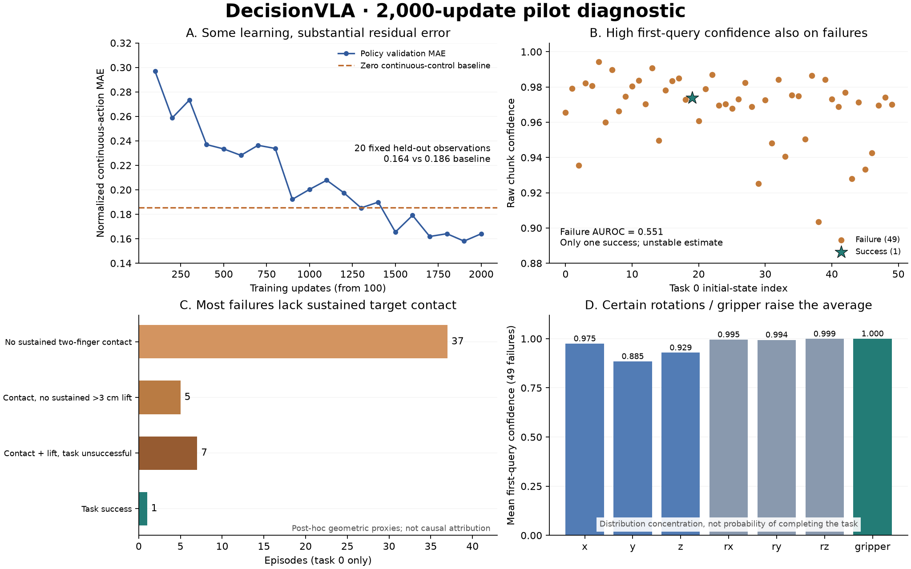

# Interim pilot diagnosis — 2026-10-24

This is a **post-hoc diagnosis of the first completed task, not the final Spatial result**. It uses checkpoint 2,000, task 0, all 50 official initial states, and the existing evaluation's saved traces. The evaluation, checkpoint, primary confidence metric and protocol remain unchanged. No new policy inference, training or simulator stepping was performed for this diagnosis. The 500-episode evaluation continues separately.



## Training adequacy

The 2,000 optimizer updates presented 16,000 observation anchors (accumulation 8), equivalent to **0.287 anchor epochs** over 55,672 available anchors. There were 14,007 distinct anchors (25.16%). Overlapping eight-action chunks nevertheless supervised **49,185 distinct action time steps (88.35%)**: the anchor count must not be presented as a claim that 75% of all action labels were unseen.

On the 20 fixed held-out observation frames used during training, final continuous-action MAE was **0.16407**, versus **0.18558** for always-zero continuous controls: an 11.59% reduction. Gripper accuracy was 92.11%, versus a 54.61% majority baseline. These are imitation metrics, not rollout success. Validation denoising CE fell from 2.0604 at 1,000 updates to 1.9072 at 2,000; MAE improved from 0.2003 to 0.1641 but fluctuated around 0.16–0.18 in the last 500 updates.

The model has learned some actions, but this short exposure and residual error make insufficient adaptation plausible. They do not prove that additional updates alone will fix closed-loop behavior. The repeated 20-frame validation is small. More broadly sampled, phase- and axis-specific validation is needed before selecting a training budget. There is no rank-controlled comparison supporting an increase beyond rank 32.

Evidence: [training diagnostic and full validation curve](../training-diagnostic.json).

## Where task 0 fails

Task 0 has **1 success / 50 episodes (2.0%)**. Restoring all **10,939 saved simulator states** produced a maximum state difference of `2.220446049250313e-16` (quaternion normalization during forward; tolerance `1e-12`). Every final simulator success predicate agreed with the recorded label.

| Mutually exclusive diagnostic category | Episodes |
| --- | ---: |
| No sustained bilateral target contact | 37 |
| Sustained contact, without sustained >3 cm lift | 5 |
| Sustained contact and lift, task unsuccessful | 7 |
| Task success | 1 |

"Sustained" means at least three consecutive saved states. Bilateral contact is a contact-geometry proxy, not proof of stable grasp; absence does not rule out pushing or brief contact. Lift means target-center height relative to its own settled initial height. These post-hoc categories describe failure stages, not causal mechanisms.

For example, failed init 1 had first confidence **0.9792**, essentially no target displacement, and minimum end-effector/target-center distance **16.39 cm**. Failed init 0 had first confidence **0.9655**, a maximum height gain **4.03 cm**, and final target/plate horizontal-center separation **14.86 cm**. Successful init 19 had first confidence **0.9739**, height gain **14.35 cm**, and final horizontal separation **2.00 cm**. The dominant observed problem is reaching sustained target contact; there are also post-contact failures.

Evidence: [geometry and all 50 rows](geometry.json), [derived trajectories](geometry-traces.npz), [summary](summary.json).

## Why confidence remains high

1. **The score measures distribution concentration.** The implemented ordered score is `clip(1 - E[abs(action_bin - mode)] / uniform_MAD, 0, 1)`, with a binary choice score for the gripper. A narrow distribution centered on the wrong action still scores highly. Neither correctness, distance to the target nor task success appears in this formula. See the [confidence implementation](../../../src/decisionvla/confidence.py) and the [upstream Jev confidence definitions](https://docs.typesafe.ai/confidence).
2. **Averaging masks axis-specific uncertainty.** Across the 49 failures, first-query translation confidence averaged **0.92934**, rotations **0.99611**, and gripper **0.99989**. The average over all 56 components was **0.96803**. Even translation alone is high, so averaging is only part of the explanation. Mean minimum-component confidence was 0.56059, but its exploratory failure AUROC was only 0.53061; replacing the mean with a minimum is not an established fix.
3. **The distribution is conditional on a sampled denoising canvas.** The final readout follows three previous passes. Its input retains previous sampled tokens with probability 0.75 and replaces them with probability 0.25. Training also includes clean positions in the denoising loss. These facts make self-consistency a plausible contributor to concentration, but a copying failure has **not** been demonstrated. No explicit self-conditioning feature is enabled. A matched multi-seed/denoising-pass probe would distinguish this hypothesis from genuinely stable observation-conditioned predictions.
4. **First-query certainty is temporally distant from success.** A local eight-action distribution is compared with an outcome up to 220 controls later. Whole-episode mean confidence was 0.89407 for failures and 0.91086 for the one success. Its exploratory AUROC is 0.91837, but this uses future information and unequal episode lengths (successful init 19 stops at 109 controls; all failures reach 220). It is not evidence of prospective failure prediction.

First-query mean confidence was **0.96803 for failures versus 0.97387 for the success**. Twenty-two failures scored higher than the sole success. The task-0 primary-direction AUROC is **0.55102**; with only one success its apparent discrimination is unstable. Calibration cannot by itself create a ranking signal absent from raw scores. No threshold or metric has been selected using these labels.

All 50 episodes / 1,386 queries passed artifact SHA checks, probability and metric recomputation, argmax/decoded-action agreement, and executed-chunk equality. See [probability audit](probability-audit.json). This rules out a trace/report mismatch in this cohort, not model or preprocessing defects in general. Code inspection confirms the same 180-degree image rotation and action codec in training and evaluation; the earlier dataset alignment audit records the one-step action offset.

## Next discriminating checks (proposed, not launched)

- Finish the fixed 500-episode run and its original within-task AUROC/CI analysis. Retain undefined results for tasks without outcome variation.
- Expand demonstration validation across tasks and grasp phases; report translation/rotation error separately. Compare fully noisy input and partially clean input to separate observation-to-action learning from denoising ease.
- Probe the same observations with different denoising passes and seeds, preserving the original checkpoint. Check observation dependence and action consistency before attributing confidence to canvas copying.
- If additional training is chosen, predefine an extended schedule with comparable 2k/5k/10k checkpoints and a separate development selection protocol. At unchanged effective batch 8, 10k is about 1.44 anchor epochs and 20k about 2.87. These are coverage calculations, not evidence that either budget is sufficient. The completed run's resume validation requires an unchanged schedule; an extension needs explicit schedule/provenance handling.
- Evaluate any success-calibration or confidence-triggered control separately using held-out episodes. The current score supports inspecting action uncertainty; it is not yet a calibrated reliability estimate or a causal explanation of decisions.

## Reproduction

Use the pinned training and LIBERO simulator environments recorded by the main report. Both diagnostic commands are CPU-only; the geometry command supports the two-object target/goal task used here. Source data and checkpoints remain on the server.

```sh
python scripts/diagnose_training.py --run RUN --data DATA --output training-diagnostic.json
python scripts/diagnose_rollout_states.py --results RESULTS --output diagnostic-task0 --task-id 0 --episodes 50
# The plot requires matplotlib 3.11.2 in addition to NumPy.
python scripts/plot_pilot_diagnostic.py --report-root reports/libero-spatial-confidence
```

The training JSON binds to run/event hashes; geometry binds to the contract and all 50 result/trace hashes. Plot summary binds to both JSON inputs and the derived NPZ. No original dataset images or raw simulator trajectories are included in Git.
